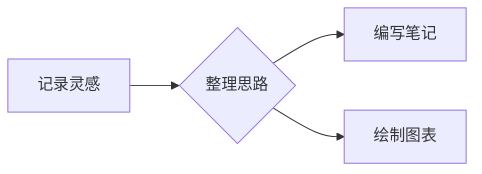
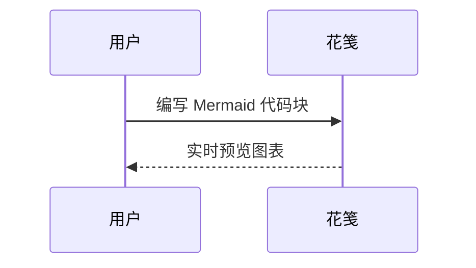
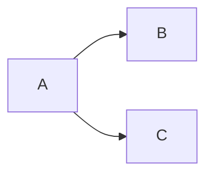
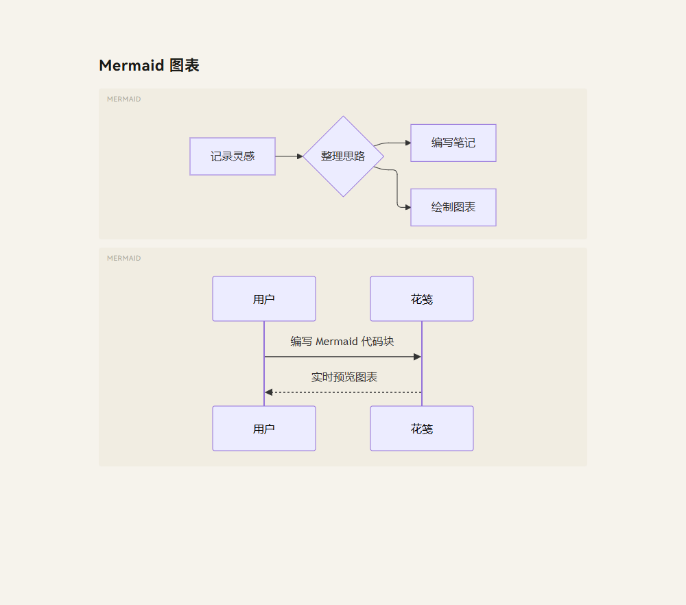
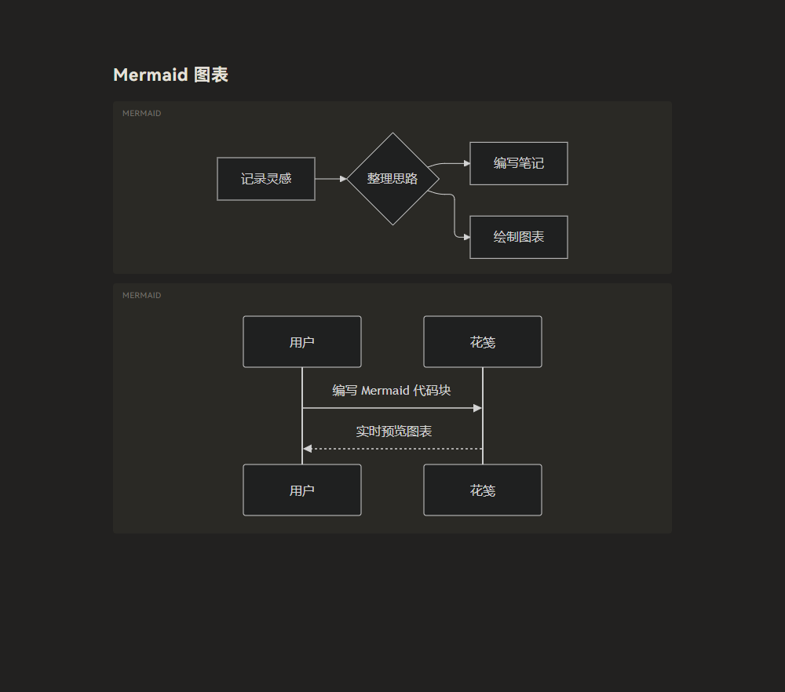

# Mermaid 图表

在笔记中使用语言为 `mermaid` 的围栏代码块，切换到预览即可显示图表。主窗口、便签窗口和磁贴使用相同的渲染方式，无需启用 HTML 渲染，也无需联网。

使用 Mermaid 11 配合官方 `@mermaid-js/layout-elk` 扩展，默认布局为 **ELK**。流程图等支持可选布局的图表会使用 ELK；时序图等具有专用布局的图表仍使用自己的布局方式。

````markdown

````

也可以使用时序图、类图等 Mermaid 支持的图表语法：

````markdown

````

图表随应用的深浅主题更新。右上角的复制按钮复制 Mermaid 源码；语法错误时显示提示和源码，修改后重新渲染，不影响其他图表或普通代码块。图表以严格安全模式渲染，不启用 Mermaid 的点击回调。

可以通过图表内的配置显式切回 Dagre：

````markdown

````

以下截图来自 Windows Edge 中的 Markdown 预览组件，非 Tauri 桌面窗口。




