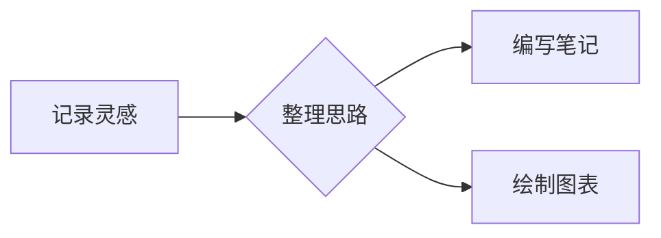
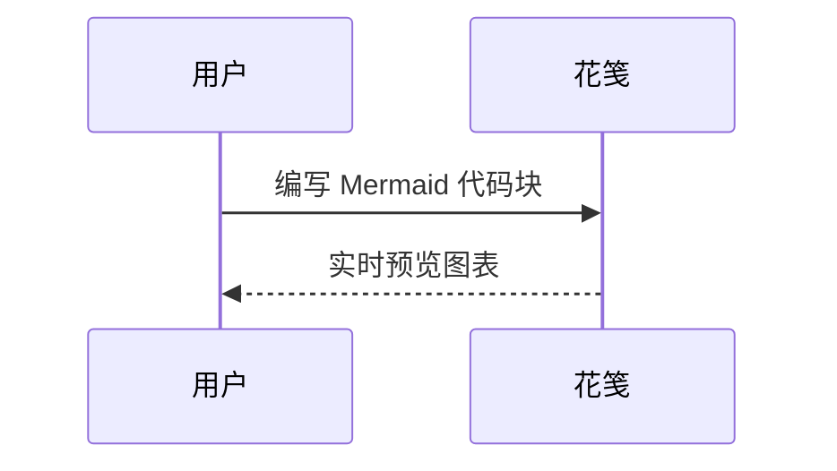
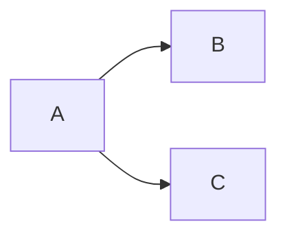
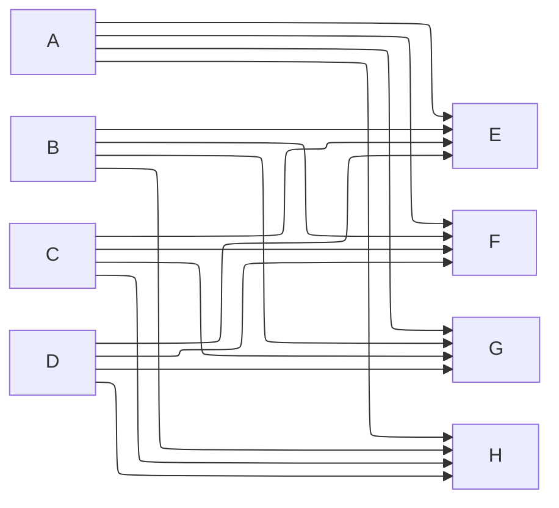
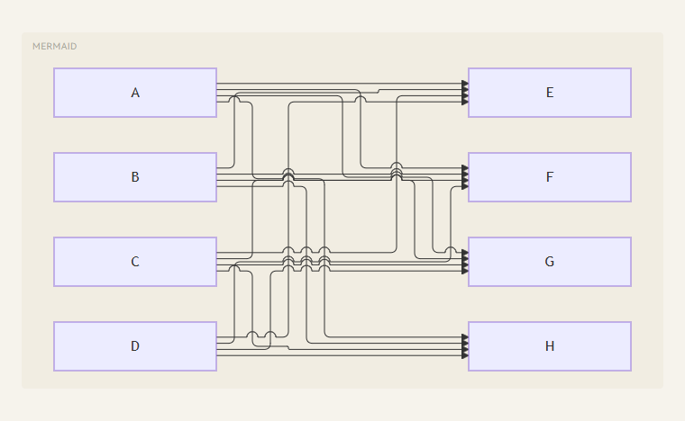

# Mermaid 图表

在笔记中使用语言为 `mermaid` 的围栏代码块，切换到预览即可显示图表。主窗口、便签窗口和磁贴使用相同的渲染方式，无需启用 HTML 渲染，也无需联网。

使用 **Mermaid 12** 内置的 **ELK**，无需安装或注册独立布局扩展。默认启用 ELK 布局和交叉跳线桥（`elk.lineHops: true`），保留经典外观（`look: classic`）。流程图等支持可选布局的图表会使用 ELK；时序图等具有专用布局的图表仍使用自己的布局方式。

源码开发需要 **Node.js 22.12+**。Mermaid 12 的浏览器基线为 ES2024 / Safari 17.4+，原生桌面运行需要相应版本的 WebView；Node.js 不是安装后运行桌面应用的前提。

````markdown

````

也可以使用时序图、类图等 Mermaid 支持的图表语法：

````markdown

````

图表随应用的深浅主题更新。右上角的复制按钮复制 Mermaid 源码；语法错误时显示提示和源码，修改后重新渲染，不影响其他图表或普通代码块。图表以严格安全模式渲染，不启用 Mermaid 的点击回调。

可以通过图表内的配置显式切回 Dagre：

````markdown

````

ELK 的交叉默认绘制小圆弧，表示两条连线经过交叉点但未连接。可以按图表改成留空断口，或用 `lineHops: false` 关闭：

````markdown

````

跳线桥只在适合的交叉位置生成；靠近拐角、空间不足或以曲线绘制的连线可能跳过，避免破坏线条。升级也可能改变节点位置和连线路由，不能保证每个交叉处都出现小桥。

以下截图来自 Windows Edge 中的 Markdown 预览组件，非 Tauri 桌面窗口。


默认圆弧跳线（上面示例删除 `elk.lineHops: gap` 后的效果）：


